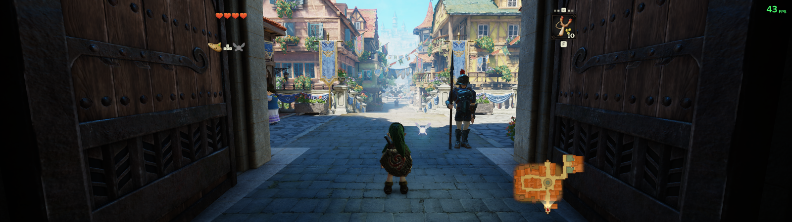
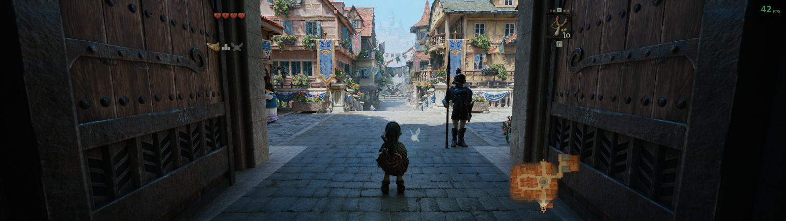

# Zelda OOT · PC graphics presets

Two Windows presets for **The Legend of Zelda: Ocarina of Time (Switch 2)**
running through [Hookshot](https://github.com/NotRexed/Hookshot), built
locally from your own `.nup`.

- **Native Quality** renders the game unchanged at full display resolution.
- **Ultra DLSS 5** adds DLSS 5 neural rendering on top of the same build.

Both include ultrawide support, 16× anisotropic filtering, keyboard/mouse
prompts and a desktop shortcut. FSR and frame generation are off.

| Native Quality | Ultra DLSS 5 |
| --- | --- |
| [](docs/images/native-5120.png) | [](docs/images/ultra-5120.png) |

Click a screenshot for the full 5120×1440 capture (Castle Town gate, same
camera position).

## Install

Download or clone this repository, open PowerShell in its folder and run:

```powershell
powershell -NoProfile -ExecutionPolicy Bypass -File .\Install.ps1 -Nup "D:\Dumps\game.nup" -Destination "D:\Games\ZeldaPresets"
```

The installer downloads hash-pinned dependencies, builds the game from your
NUP and installs both presets. The first build takes 30 minutes or more.
Then launch **Zelda Ocarina of Time - Native Quality** or
**Zelda Ocarina of Time - Ultra DLSS 5** from the desktop. Both presets share
one save folder.

- `-Preset Native` installs only Native and skips the Ultra downloads.
- The output resolution defaults to the primary display. The screenshots used
  `-Resolution 5120x1440 -TextureBudgetMB 12288` on a 24 GiB RTX 4090.
- Ultra uses a community-patched `nvngx_dlssnr.dll` whose Authenticode
  signature is broken (`HashMismatch`); the installer checks its SHA-256.
  See [the runtime notes](docs/DEPENDENCIES.md#neural-rendering-runtime).

More: [install options, saves, removal](docs/INSTALL.md) ·
[controls](docs/CONTROLS.md) ·
[dependencies](docs/DEPENDENCIES.md) ·
[technical notes and limits](docs/TECHNICAL.md) ·
[по-русски](docs/README.ru.md)

## Requirements

- Windows x64, an SSD with about 60 GiB free, 32 GiB RAM recommended for the build.
- The supported game version: title `0400486024DEC000`, update `v131072`
  (1.1.1), guest build `e0f3ccfa`. Other versions are rejected before the build.
- Output from 1280×720 up to 5120×2160.
- Ultra: NVIDIA only. Tested on an RTX 4090 (Ada) with driver 621.14; other
  GPUs and drivers are untested.

On an i9-14900K and RTX 4090, Ultra runs at about 40–42 FPS at 5120×1440 in
Castle Town. 60 FPS is not guaranteed.

Known limits: a few pre-rendered tutorial images still show Nintendo buttons,
and the game has not been played to the end with these presets. See
[TECHNICAL.md](docs/TECHNICAL.md).

## Credits

Built on [NotRexed/Hookshot](https://github.com/NotRexed/Hookshot),
[NIGos/dlss5-bridge](https://github.com/NIGos/dlss5-bridge),
[ReShade](https://reshade.me/), RenoDX, NVIDIA DLSS,
[ARM astc-encoder](https://github.com/ARM-software/astc-encoder) and
[valentderah/totk-pc-recomp](https://github.com/valentderah/totk-pc-recomp)
(prompt drawing, MIT, originally from MacNativeGames).

The scripts in this repository are MIT licensed and were written with OpenAI
Codex. No game files, saves, keys or prebuilt executables are distributed.
Not affiliated with Nintendo or NVIDIA.
