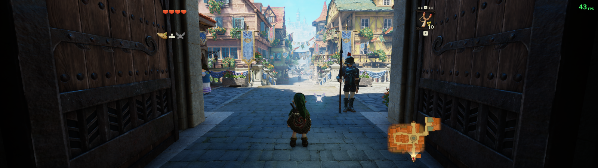
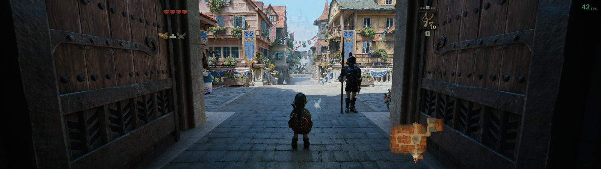

# Zelda OOT — графические пресеты для ПК

Два пресета для **The Legend of Zelda: Ocarina of Time (Switch 2)** на
[Hookshot](https://github.com/NotRexed/Hookshot). Игра собирается локально из
вашего `.nup`.

- **Native Quality** — оригинальная картинка в полном разрешении экрана.
- **Ultra DLSS 5** — то же самое плюс нейронный рендеринг DLSS 5.

В обоих есть поддержка ультрашироких мониторов, анизотропная фильтрация 16×,
подсказки для клавиатуры и мыши и ярлык на рабочем столе. FSR и генерация
кадров выключены.

| Native | Ultra |
| --- | --- |
| [](images/native-5120.png) | [](images/ultra-5120.png) |

По клику открывается кадр 5120×1440 (ворота Хайрульского посада, камера в
одной точке).

## Установка

Скачайте или клонируйте репозиторий, откройте PowerShell в его папке и выполните:

```powershell
powershell -NoProfile -ExecutionPolicy Bypass -File .\Install.ps1 -Nup "D:\Dumps\game.nup" -Destination "D:\Games\ZeldaPresets" -Language ru
```

Установщик скачает зависимости с проверкой SHA-256, соберёт игру из NUP и
поставит оба пресета. Первая сборка занимает от 30 минут. Потом запускайте
ярлык **Zelda Ocarina of Time - Native Quality** или
**Zelda Ocarina of Time - Ultra DLSS 5**. Сохранения у пресетов общие.

- `-Preset Native` ставит только Native и не скачивает компоненты Ultra.
- Разрешение по умолчанию берётся с основного монитора. Скриншоты сняты с
  `-Resolution 5120x1440 -TextureBudgetMB 12288` на RTX 4090 с 24 ГиБ.
- Ultra использует изменённую сообществом `nvngx_dlssnr.dll`, её подпись
  Authenticode недействительна (`HashMismatch`); установщик проверяет SHA-256.
  Подробнее — [в описании зависимостей](DEPENDENCIES.md#neural-rendering-runtime).

## Требования

- Windows x64, SSD с ~60 ГиБ свободного места, для сборки желательно 32 ГиБ ОЗУ.
- Версия игры: title `0400486024DEC000`, update `v131072` (1.1.1), build
  `e0f3ccfa`. Другие версии отклоняются до начала сборки.
- Разрешение от 1280×720 до 5120×2160.
- Ultra: только NVIDIA. Проверено на RTX 4090 (Ada) с драйвером 621.14.

На i9-14900K и RTX 4090 Ultra даёт около 40–42 FPS при 5120×1440 в
Хайрульском посаде. 60 FPS не гарантируются.

## Сохранения

Оба пресета используют `<папка установки>/profile/save/`. Чтобы перенести
прогресс, закройте игру и добавьте `-ImportProfile "D:\OldZelda\user"` — папку,
в которой лежит `save/`. Сохранения скопируются в новую установку, ещё одна
копия ляжет в `backups/imported-save/`. Исходные файлы не меняются.

Установщик не пишет в непустую папку, поэтому для обновления ставьте в новую.

## Ограничения

- При первом входе в сцену компилируются шейдеры: возможны подтормаживания и
  временно недорисованные материалы.
- Ultra при запуске один раз меняет размер окна и возвращает его — так
  подключается нейронный рендеринг.
- В некоторых обучающих картинках остались кнопки Switch. [Раскладка](CONTROLS.md).
- Игра не проходилась до конца. В NUP, на котором велась разработка, есть
  повреждённая текстура поздней локации.

Подробнее: [установка и диагностика](INSTALL.md),
[технические детали](TECHNICAL.md). Игровые файлы, сохранения и ключи в
репозиторий не входят.
